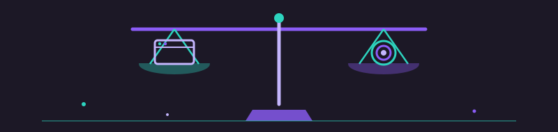

<p align="center"></p>

<p align="center"></p>



*The Holographic Scale: a browser window in violet and teal glass on one pan, a glowing target on the other, and every website weighed against the goal you named.*


# Distracting Websites: Website Productivity Analyzer

*A single-file Python tool, `tool.py`, that judges whether a website is productive for a task you describe.*

[](https://www.python.org/)
[](LICENSE)

## Quick Verdict

The tool takes no command-line flags for the goal or the site: you run it, state your task at the prompt, then enter a website. Its prompts and verdict lines look like this, for a site on its built-in known-platform list:

```text
$ python3 tool.py
Please enter the task you want to achieve: write my thesis
Enter the website URL to analyze (or 'exit' to quit): classroom.google.com

✅ classroom.google.com is productive for your task.
```

The verdict above follows the documented known-platform path: classroom.google.com is answered locally with a fixed base score of 90, with no fetch and no API call (see How it works). I also ran the tool in this workspace: `python3 tool.py --help` prints its usage text and exits 0, and with no Gemini key set it prints a short message naming the missing variable and exits instead of crashing.

---

## Contents

- [Quick Verdict](#quick-verdict)
- [How it works](#how-it-works)
- [Requirements](#requirements)
- [Setup and run](#setup-and-run)
- [Examples](#examples)
- [What it does not do](#what-it-does-not-do)
- [Tests](#tests)

---


> FETCH FAILED, SCORED AS NOT PRODUCTIVE


A single-file Python tool, `tool.py`, that judges whether a website is
productive for a task you describe. It asks what you want to achieve,
uses the Gemini API to ask follow-up questions until the task is
specific enough, then scores each website you enter against that task
and prints a productive or not productive verdict. It only advises: it
does not block anything.


<p align="center"></p>

<p class="plate"><sub>PAN 1 · THE HOLOGRAPHIC SCALE · weighed ○</sub></p>

## How it works

1. **You state a goal.** You enter the task you want to achieve. The tool scores the task description for specificity with Gemini (subject, task type, context, and resource needs). Below the threshold it generates follow-up questions and merges your answers into the task description, up to 10 rounds.
2. **You give it a website.** For each website URL you enter, the tool gathers information:
   - A small built-in list of known educational platforms (classroom.google.com and khanacademy.org) is answered locally with a fixed low distraction profile, with no fetch and no API call. Bare domains and `www.` addresses are recognized too.
   - Any other site is fetched and summarized from its title, meta description, headings, and opening paragraphs, plus simple keyword counts for entertainment, social, and advertising elements and a capped distraction ratio between 0 and 1.
3. **It returns a verdict.** Gemini scores the site against your task from 0 to 100. The site is productive at 75 or above. Known educational platforms use fixed base scores instead (for example 90 for Google Classroom, 85 for Khan Academy), and high-distraction domains such as youtube.com, facebook.com, and tiktok.com have their score scaled down (by 0.8 to 0.9 depending on the domain) before the threshold is applied.

<p align="center"></p>

<p class="plate"><sub>PAN 2 · THE HOLOGRAPHIC SCALE · weighed ○</sub></p>

## Requirements

- Python 3
- The packages in `requirements.txt`: `requests`, `beautifulsoup4`,
  and `google-genai`
- A Gemini API key from Google AI Studio
- Network access, for the Gemini API and for fetching websites


<p align="center"></p>

<p class="plate"><sub>PAN 3 · THE HOLOGRAPHIC SCALE · weighed ○</sub></p>

## Setup and run

```sh
pip install -r requirements.txt
export GEMINI_API_KEY="your key here"
python3 tool.py
```

`GOOGLE_API_KEY` is also accepted. With no key set, the tool prints a
short message naming the missing variable and exits instead of
crashing. Type `exit` or `quit` at the website prompt to stop; closing
input (Ctrl-D) also exits cleanly. A blank task is asked for again,
and a blank line at the website prompt just asks again instead of
scoring an empty address. `python3 tool.py --help` prints a short
usage text and exits 0, and it works before the packages above are
installed, because the imports for them happen inside the functions
that use them. Any other argument exits 2.


## Examples

These are the example sites whose scores are documented in this README and in `tool.py`. Sites that are not on the known-platform list are scored by Gemini against your task from 0 to 100, so no fixed score is published for them here.

| Website | Goal | Verdict | Score |
| --- | --- | --- | --- |
| classroom.google.com | Any task (known educational platform, answered locally) | Productive | 90 (fixed base score) |
| khanacademy.org | Any task (known educational platform, answered locally) | Productive | 85 (fixed base score) |

---

<p align="center"></p>

<p class="plate"><sub>PAN 4 · THE HOLOGRAPHIC SCALE · weighed ○</sub></p>

## What it does not do

- It does not block websites or apps, and there is no browser
  extension. Blocking, app detection, and a Todoist integration were
  ideas in the original project notes and are not implemented.
- Fetched page content and your task description are sent to the
  Gemini API for scoring, so do not point it at pages or tasks you
  need to keep private.
- Sites that refuse scraping return limited information, and the tool
  then reports the site as not productive rather than guessing. An
  HTTP error status (a 404, a block page) counts as a failed fetch
  the same way: the error page itself is not scored as content.
- A model reply with a score outside 0 to 100 is treated as no score
  at all, and the check it fed fails closed.


<p align="center"></p>

<p class="plate"><sub>PAN 5 · THE HOLOGRAPHIC SCALE · weighed ○</sub></p>

## Tests

```sh
python3 -m unittest discover -s tests
```

22 tests, all passing when I last ran them. They mock the Gemini
client and every fetch, so no network or API call happens: domain
normalizing, score parsing including the out of range case, question
cleaning, the specificity threshold, the known platform fast path,
the high distraction scaling, the failed fetch verdict, the blank
line handling in the main loop, and the entry points (`--help` at
exit 0 without the API packages installed, an unknown argument at
exit 2, and the no key message). The live path against the real
Gemini API is not covered by these tests.
