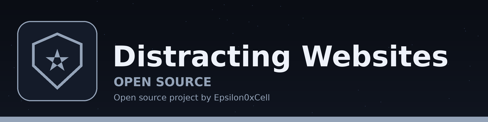

# Distracting Websites: Website Productivity Analyzer

A single-file Python tool, `tool.py`, that judges whether a website is
productive for a task you describe. It asks what you want to achieve,
uses the Gemini API to ask follow-up questions until the task is
specific enough, then scores each website you enter against that task
and prints a productive or not productive verdict. It only advises: it
does not block anything.

## How it works

1. You enter the task you want to achieve.
2. The tool scores the task description for specificity with Gemini
   (subject, task type, context, and resource needs). Below the
   threshold it generates follow-up questions and merges your answers
   into the task description, up to 10 rounds.
3. For each website URL you enter, the tool gathers information:
   - A small built-in list of known educational platforms
     (classroom.google.com and khanacademy.org) is answered locally
     with a fixed low distraction profile, with no fetch and no API
     call. Bare domains and `www.` addresses are recognized too.
   - Any other site is fetched and summarized from its title, meta
     description, headings, and opening paragraphs, plus simple
     keyword counts for entertainment, social, and advertising
     elements and a capped distraction ratio between 0 and 1.
4. Gemini scores the site against your task from 0 to 100. The site is
   productive at 75 or above. Known educational platforms use fixed
   base scores instead (for example 90 for Google Classroom, 85 for
   Khan Academy), and high-distraction domains such as youtube.com,
   facebook.com, and tiktok.com have their score scaled down (by 0.8
   to 0.9 depending on the domain) before the threshold is applied.

## Requirements

- Python 3
- The packages in `requirements.txt`: `requests`, `beautifulsoup4`,
  and `google-genai`
- A Gemini API key from Google AI Studio
- Network access, for the Gemini API and for fetching websites

## Setup and run

```sh
pip install -r requirements.txt
export GEMINI_API_KEY="your key here"
python3 tool.py
```

`GOOGLE_API_KEY` is also accepted. With no key set, the tool prints a
short message naming the missing variable and exits instead of
crashing. Type `exit` or `quit` at the website prompt to stop; closing
input (Ctrl-D) also exits cleanly.

## What it does not do

- It does not block websites or apps, and there is no browser
  extension. Blocking, app detection, and a Todoist integration were
  ideas in the original project notes and are not implemented.
- Fetched page content and your task description are sent to the
  Gemini API for scoring, so do not point it at pages or tasks you
  need to keep private.
- Sites that refuse scraping return limited information, and the tool
  then reports the site as not productive rather than guessing.
